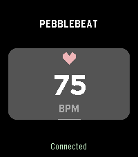

# PebbleBeat

A simple Pebble Time 2 watch app that displays your heart rate and forwards
heart rate, the latest beat interval, and battery level to a WebSocket server
through your paired phone.



**Setup**

1. Install PebbleBeat on your watch and keep it connected to the Pebble phone app.
2. Run a WebSocket server that your phone can reach.
3. Open PebbleBeat's settings in the pebble phone app and enter your server's URL,
   such as `ws://192.168.1.100:8080` or `wss://example.com/heartbeat`.
4. Save the settings, then close and reopen PebbleBeat to connect.
5. Note: The application must be open in the foreground to send events

For a server running on your computer, use the computer's network address.

The watch shows **Connected** when the WebSocket connection is open. If the
connection drops, the phone retries every five seconds.

**Data format**

Each heart-rate update sends a JSON message:

```json
{
  "bpm": 72,
  "latest_rr_ms": 833,
  "battery": 85
}
```

- `bpm`: heart rate in beats per minute.
- `latest_rr_ms`: the latest peak-to-peak interval reported by the watch, in
  milliseconds.
- `battery`: watch battery percentage.


**Recommended Apps**

[Iron Heart OSC Relay](https://github.com/nullstalgia/iron-heart)

**Building**

With Node.js, npm, and a Pebble SDK supporting the Time 2 (`emery`)

```sh
npm install
pebble build
```

The project currently targets Pebble Time 2 only.
